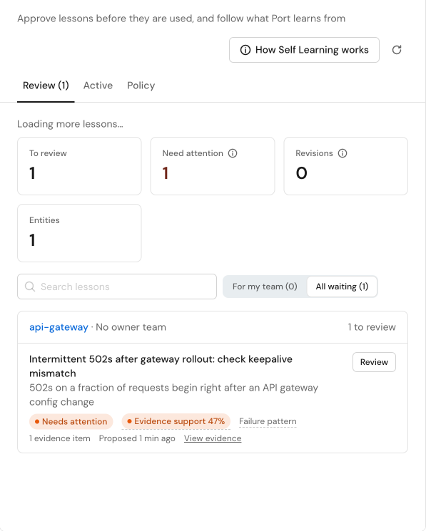

# Self Learning

The admin page of **Self Learning** for [Port](https://app.port.io). Self Learning turns finished work in your catalog (incidents, bugs, post-mortems and other sources you choose) into short, evidence-backed **lessons** attached to your catalog entities, and serves the approved ones to your AI agents. This page is where people review those lessons, browse the active ones, and where an admin creates the pipeline of each source. It runs on a dashboard page and reads everything it needs from the catalog Self Learning creates; it has no parameters.

## Preview image



## Features

- **Review** tab: every lesson waiting for a decision, with its evidence and the result of each automatic check (backed by the evidence, nothing invented, not overgeneralized, duplicates and conflicts). Approve and publish, change the text and approve, reject with a reason, or keep the current version of a revised lesson. Reviews that stopped before a decision can be restarted.
- **Active** tab: the lessons agents get today, with stale lessons and lessons whose entity was deleted called out. An admin can re-check active lessons.
- **Policy** tab: one table of the sources Port learns from, with what lessons attach to, their on/off state and their last pipeline run. An admin can add a source with **+ Add new learning**, create a source's pipeline, pause or resume each source on its row, and run a source on past items (7, 30 or 90 days, with a count to confirm first).
- Clear states: a "not set up" page with a link to the guide when Self Learning is not installed, and a banner when it was installed with another version of the guide.
- Dark and light theme from Port.

## Prerequisites

### Self Learning set up in your organization

Apply the guide **[Set up self-learning agents with lessons](https://docs.port.io/guides/all/set-up-self-learning-agents)** first, in Port AI. It creates the blueprints, workflows, policy and install record this page reads, and it adds at least one source.

Until the guide has finished (its install record `lessons_install/default` has `setup_complete: true`), the page shows only **"Self Learning is not set up in this organization"** and a link to the guide. It never creates or repairs the setup itself.

### Access

- Anyone who can open the page can read it. Deciding on lessons and changing the policy depend on the user's role and teams (see [Who can do what](#who-can-do-what)).
- To upload the plugin yourself: a Port Admin and the [port-plugins-cli](https://www.npmjs.com/package/@port-labs/port-plugins-cli) (Node.js **≥ 20**).

## Plugin parameters

This plugin has no parameters. `upload-params.json` is `{}`: the page finds the lesson, policy and install blueprints by their fixed identifiers, and the primary blueprint (for example `service`) from the install record.

## Setup

The guide's step **"Add the Self Learning admin page"** does all of this for you in Port AI and records the plugin and the page in the install record, so that removing Self Learning later also removes them. Use the steps below only if you add the page yourself.

### Install from the Plugins Library

Once this plugin is in the Port Plugins Library, install it with identifier `self-learning`. In Port AI with the Port MCP, ask it to install the `self-learning` library plugin (tool `install_library_plugin`).

### Upload

Before the plugin is in the library, upload this folder's build with the CLI:

```bash
port-plugins upload \
  --file dist/index.html \
  --identifier self-learning \
  --title "Self Learning" \
  --upsert
```

Keep the identifier `self-learning`: the guide's collision check and removal look for the plugin by that name. See [@port-labs/port-plugins-cli](https://www.npmjs.com/package/@port-labs/port-plugins-cli) for CLI install and credential setup (tokens vs client credentials, region).

`dist/index.html` is prebuilt and committed. It is built from the Self Learning guide package (`node plugin/build.mjs`, no npm dependencies), so `npm run build` here only prints that note.

### Add in Port

1. In the catalog sidebar, open the **AI** folder the guide created and add a **Dashboard** page with identifier `self_learning_admin` and title **Self Learning**.
2. On that page: **Add widget** → **Custom widget** → **Self Learning**.
3. There are no parameters to set. Save.

## Who can do what

| | Admin | Member of the entity's owner team | Everyone else |
|---|---|---|---|
| Read the Review, Active and Policy tabs | yes | yes | yes |
| Decide on a lesson (approve, edit, reject, keep current) | any lesson, including one whose entity has no owner team | lessons of entities their team owns (the first owner team decides) | no |
| + Add new learning, Create pipeline, Finish setup | yes | no | no |
| Pause or resume a source, Run on past items, re-check active lessons | yes | no | no |

The first sources are proposed by Port AI (Ask AI) during setup: it reads the org and writes the ones an admin confirms. Later sources are added on this page: **+ Add new learning** on the **Policy** tab, pick the blueprint (only blueprints with a direct relation to the blueprint lessons attach to), the field and values that mean finished, the evidence fields and the relation, then **Save and turn on**. **Pause** on a source's row stops learning from it (its status is set to off and its pipeline's triggers are unpublished); **Resume** turns it back on.

## Create pipeline

Each source runs through its own pipeline workflow, `lessons_pipeline_<source blueprint>`. Port AI adds the sources it proposed to the policy and leaves the pipeline to this page; **+ Add new learning** writes the source and its pipeline in one go. On the **Policy** tab, an admin sees an action cell at the end of each source's row. It shows **Pause** when the source is on and its pipeline was created by Self Learning, **Resume** when the source is off (Resume creates the pipeline again when it is missing), and otherwise the state of the source's pipeline:

- **Create pipeline** (Admin): fills the pipeline template shipped in this page with the source's settings and creates the workflow. The page first marks the step as pending in the install record, creates the workflow, reads it back, then records it as created by Self Learning. Port learns from that source's items that finish from then on; use **Run on past items** for older ones.
- **Created**: the pipeline exists and Self Learning created it (shown in place of **Pause** while the policy's `paused` flag is set).
- **Finish setup**: a previous Create pipeline created the workflow but did not finish recording it. The page records it only if the workflow is exactly the filled template for that source; otherwise it stops as below.
- **A workflow named `lessons_pipeline_<source>` already exists and was not created by Self Learning**: the page never takes over a workflow someone else made. Rename or delete that workflow, then try again.
- **This source is off** or **Unknown source kind**: click **Resume** on the source's row, or add the source again with **+ Add new learning**.

## Troubleshooting

| Symptom | Cause | Fix |
|---------|-------|-----|
| "Self Learning is not set up in this organization" | No install record, or the guide did not finish | Apply [the guide](https://docs.port.io/guides/all/set-up-self-learning-agents) in Port AI to the end, then reload the page. |
| "Self Learning in this org was set up with another version of the guide; re-apply the guide." | The install record's version differs from the one this page was built for | Re-apply the current guide. The page keeps working meanwhile. |
| No **Create pipeline** button | You are not an Admin, or the source is off or of an unknown kind (the cell says which) | Ask an Admin, or click **Resume** on the source's row. |
| "... already exists and was not created by Self Learning" | A workflow with the pipeline's identifier exists and is not recorded as Self Learning's, or its content is not the template | Rename or delete that workflow, then **Create pipeline** again. |
| "The pipeline was not created. Try again." | Port refused the workflow (for example a source setting it cannot accept); nothing was recorded | Check the source's settings against the guide's values reference, then try again. |
| The row's action cell says "Could not be checked" | The page could not read the workflows | Reload the page; it needs an Admin session. |
| Approve or Reject missing on a lesson | You are not in the entity's first owner team, or the entity has no owner team ("Admin decides") | Ask a member of that team or an Admin. |
| "The backfill worker (lessons_backfill) is missing" on Run on past items | An older install without the backfill workflow | Re-apply the guide. |
| "Your session has expired. Refresh the page." | The Port session token expired | Reload the page. |
| Re-applying the guide stops at the collision check on `self-learning` or `self_learning_admin` | The plugin or page was added by hand, so the install record does not list them | Delete the hand-made page and plugin, then let the guide's admin page step create them. |
| Blank widget | The page is not the `self-learning` plugin, or an old upload | Re-upload `dist/index.html` with the command above and reload. |
